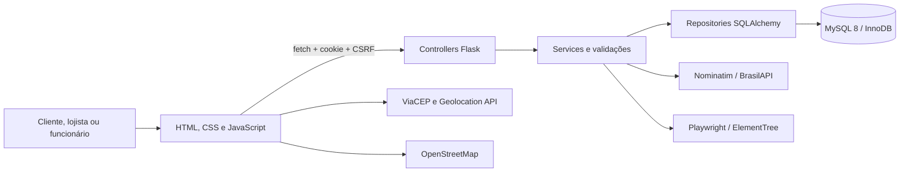

# Arquitetura do BoraObra

## Visão geral

O BoraObra é uma aplicação web monolítica em camadas. O Flask entrega páginas HTML estáticas e uma API JSON; o navegador monta componentes compartilhados e consome a API com JavaScript. Não há Jinja nem etapa de build do frontend. O MySQL 8 é o único banco suportado.

## Responsabilidades

### Frontend

- apresenta páginas separadas por perfil e funcionalidade;
- monta cabeçalho, menus, modais e navegação compartilhada;
- mantém estado visual, carrinho e preferência de tema;
- faz validações imediatas de usabilidade, sem substituir o backend;
- envia requisições pelo cliente central de `frontend/static/js/api.js`;
- nunca é fonte de verdade para preço, estoque, permissões ou total do pedido.

### Backend

- autentica e autoriza por sessão, perfil e loja;
- valida definitivamente os dados;
- recalcula preços, diárias e totais;
- controla estoque e transições de pedidos;
- filtra relatórios e gera XML, PDF e PNG;
- protege operações de alteração com CSRF;
- converte exceções esperadas em mensagens públicas seguras.

## Camadas

| Camada | Local | Responsabilidade |
|---|---|---|
| Composição | `app.py` | Cria a aplicação, registra blueprints, páginas, hooks e erros globais |
| Configuração | `backend/config/` | Lê ambiente e centraliza MySQL, cookies e limites |
| Controllers | `backend/controllers/` | Traduz HTTP em chamadas de casos de uso |
| Services | `backend/services/` | Regras, validações, acesso e casos de uso |
| Repositories | `backend/repositories/` | Persistência, consultas e transações |
| Models | `backend/models/` | Mapeamento SQLAlchemy das entidades |
| Banco | `backend/database/` | Conexão, validação do schema e SQL versionado |
| Middleware | `backend/middleware/` | Correlação e medição das requisições |

## Fluxo de uma requisição

1. `apiRequest()` envia cookie de sessão e, em mutações, `X-CSRF-Token`.
2. O controller valida o formato HTTP e chama um service.
3. `AcessoService` confirma conta ativa, perfil e isolamento de loja.
4. O service valida entradas e executa a regra de negócio.
5. O repository consulta ou persiste usando a sessão SQLAlchemy.
6. O controller retorna JSON ou arquivo; erros esperados usam `{ "erro": "..." }`.
7. A resposta recebe `X-Request-ID`, `Server-Timing`, headers de segurança e `no-store` nas APIs.

## MySQL e transações

A URL `mysql+pymysql` é construída apenas com variáveis de ambiente. O pool usa `pool_pre_ping`, reciclagem e limite de conexões. Na inicialização, `validar_schema()` confirma tabelas, colunas e nulabilidade sem criar ou apagar estruturas.

O checkout é a transação crítica: o servidor bloqueia produtos em ordem estável com `SELECT ... FOR UPDATE`, recalcula valores e grava pedido, itens e baixa de estoque. A combinação `user_id + idempotency_key` evita duplicação por retry. Cancelamentos de venda também bloqueiam produtos antes de devolver estoque.

## Autenticação e autorização

- senhas usam o hash do Werkzeug e nunca são retornadas;
- a sessão Flask é assinada, `HttpOnly`, `SameSite=Lax` e possui validade configurável;
- login tem limite local de cinco falhas em cinco minutos;
- toda mutação `/api` exige CSRF;
- `AcessoService` revalida a conta e o perfil em cada requisição;
- clientes acessam apenas os próprios pedidos;
- lojistas e funcionários acessam apenas a loja vinculada;
- somente lojistas administram loja e funcionários.

## Tratamento de erros

`ServiceError` representa falhas esperadas e amigáveis. Erros HTTP, conflito de integridade e exceções inesperadas possuem handlers globais. Detalhes técnicos ficam no log com identificador de correlação; stack traces e SQL não são retornados ao navegador.

## Uploads

Logotipos de loja aceitam PNG, JPEG e WebP de até 2 MB e dimensões entre 48 e 4096 pixels. O backend valida extensão, MIME e conteúdo real com Pillow, corrige orientação, converte para WebP e gera uma miniatura 96×96 para o mapa. Arquivos recebem UUID e ficam fora do Git em `frontend/static/uploads/lojas/`.

## Integrações e relatórios

- **ViaCEP:** preenchimento de endereço no navegador; falha mantém campos editáveis.
- **Nominatim:** geocodificação de lojas no backend; usa User-Agent configurável.
- **BrasilAPI:** fallback aproximado por CEP.
- **Leaflet/OpenStreetMap:** mapa e tiles no cliente.
- **Geolocation API:** posição do cliente fica no navegador e alimenta Haversine.
- **Chart.js:** gráficos locais de dashboard e relatório.
- **Playwright:** renderiza HTML controlado pelo servidor em PDF e PNG.
- **ElementTree:** gera XML filtrado sem template externo.

## Decisões e limitações

- frontend sem framework e sem Jinja, adequado ao porte atual;
- IDs internos permanecem nos contratos para relacionamentos, mas não devem ser exibidos como conteúdo;
- listagens operacionais ainda carregam coleções completas e paginam no cliente;
- parte das agregações de relatório ocorre em Python após filtragem SQL;
- Playwright abre navegador durante a requisição e pode ocupar um worker;
- rate limiting é local ao processo; produção com múltiplos workers precisa de armazenamento compartilhado;
- locações não bloqueiam reservas concorrentes por intervalo;
- não há recuperação de senha, pagamentos reais, procedures, views ou triggers.
- o teste `test_legacy_database_is_retained_but_not_referenced_by_runtime` ainda exige um arquivo SQLite legado que não existe no repositório; o teste deve ser atualizado ou a decisão de manter o artefato deve ser formalizada antes da `main`.
