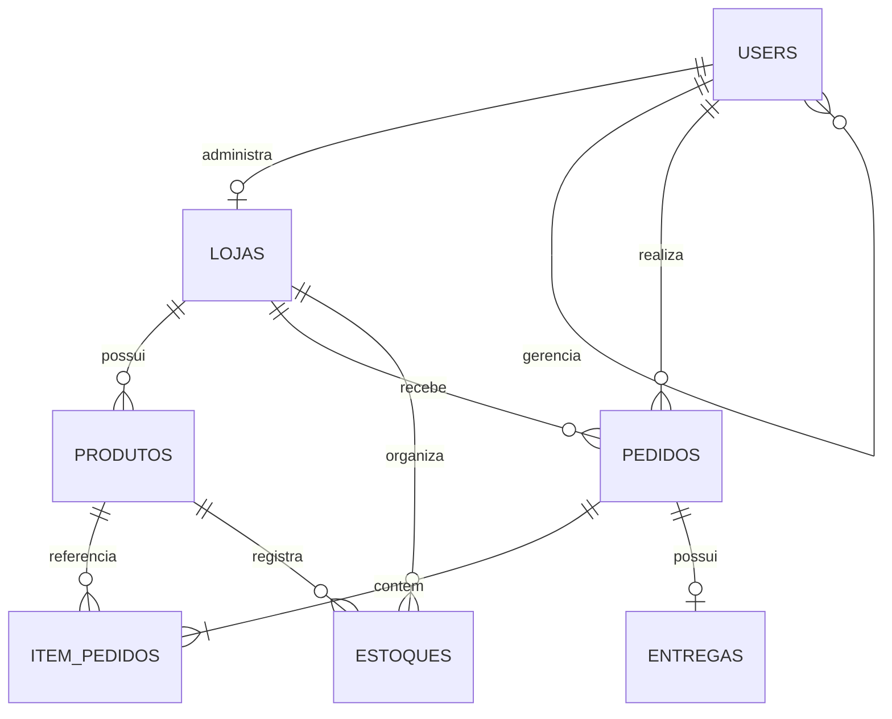

# Banco de dados

O único banco suportado é **MySQL 8**, InnoDB, `utf8mb4` e `utf8mb4_unicode_ci`. O nome padrão é `bora_obra`; testes usam outro banco terminado em `_test`.



## Entidades

- `users`: cliente, lojista e funcionário; e-mail único, hash de senha, endereço, status e vínculo opcional ao responsável.
- `lojas`: uma por lojista; dados administrativos, endereço, coordenadas, estado e logos.
- `produtos`: loja, descrição, modalidades, preços `DECIMAL(12,2)`, estoque, SKU e imagem.
- `pedidos`: cliente, loja, status, modalidade, total, pagamento, endereço, datas e chave idempotente.
- `item_pedidos`: quantidade, preço histórico e diárias por produto.
- `estoques`: registro auxiliar por loja/produto; o pedido atual usa `produtos.estoque`.
- `entregas`: relação opcional um-para-um; o fluxo atual usa principalmente `pedidos.status`.

## Chaves e integridade

- PKs `INT UNSIGNED AUTO_INCREMENT`;
- FKs de propriedade usam `RESTRICT`; itens usam `CASCADE` apenas ao excluir pedido;
- únicos: e-mail, lojista da loja, entrega do pedido e `(user_id, idempotency_key)`;
- dinheiro usa `DECIMAL`, datas usam `DATE`/`DATETIME`;
- domínios de perfil e status são validados pelo backend, não por `CHECK` no schema atual.

## Índices

- `users(responsavel_id)`;
- `produtos(loja_id)` e `(loja_id, categoria, nome)`;
- `pedidos(user_id)`, `(loja_id)`, `(loja_id, created_at)` e `(loja_id, status, created_at)`;
- `item_pedidos(pedido_id)` e `(produto_id)`;
- `estoques(loja_id)` e `(produto_id)`;
- índices únicos correspondentes às constraints.

## Instalação e migrations

1. Nova instalação: `backend/database/sql/schema/bora_obra.sql`.
2. Banco existente, em ordem:
   1. `20261011_report_indexes.sql`;
   2. `20261012_order_idempotency.sql`.

As migrations consultam `information_schema`. Não há Alembic, procedures, views ou triggers ativos.

## Transações críticas

Criação de pedido bloqueia produtos com `SELECT ... FOR UPDATE`, recalcula valores e grava pedido, itens e estoque em uma transação. Cancelamento bloqueia antes da devolução. Repositories fazem rollback em falha.

## Verificação

```powershell
python -m backend.database.check_connection
```

Erros comuns: variáveis `DB_*` ausentes, acesso negado, banco inexistente ou migration pendente. A inicialização não cria tabelas nem volta para SQLite.

> Nunca aponte testes para o banco principal: a suíte recria tabelas somente quando o nome termina em `_test`.
